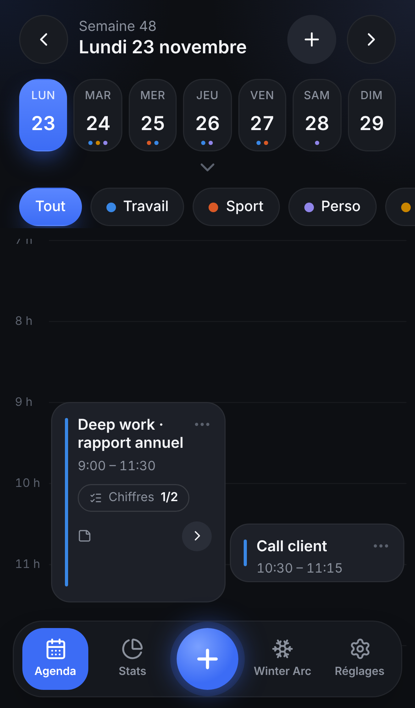

# Givre — planning & Winter Arc

Application mobile pensée pour l’iPhone (installable depuis Safari, plein écran, hors connexion) pour :

- **Agenda** : vue semaine avec créneaux horaires, vue jour en touchant une date ; créer, modifier, **déplacer (appui long puis glisser)**, **changer la durée (tirer le bas d’une carte)** et supprimer créneaux et tâches ; titre, date, heures, catégorie, notes, sous-tâches ; répétitions.
- **Catégories** personnelles avec leur couleur (Travail, Sport, Perso, Déplacements…), reprise dans l’agenda et les statistiques.
- **Statistiques** : temps planifié par catégorie (heures et minutes) semaine par semaine, graphique aux couleurs de l’agenda, détail jour par jour. Une tâche datée sans horaire s’affiche dans la journée mais n’est pas comptée.
- **Winter Arc** : dates de début et de fin, habitudes quotidiennes ou certains jours, écran « Aujourd’hui » (une touche = validé), historique en calendrier, correction d’un jour passé, taux de réussite par habitude, progression du challenge, séries.
- **Google Agenda** : vraie connexion OAuth au compte Google, choix des agendas, synchronisation dans les deux sens, événements récurrents, journées entières, fuseau Europe/Paris, sans doublons, état de connexion et date de la dernière synchronisation réussie.

Les données sont enregistrées sur l’iPhone (stockage local) et conservées après fermeture. Réglages → Données permet d’exporter / importer une sauvegarde.



---

## 1. Lancer en local

Prérequis : Node.js 20 ou plus.

```bash
npm install
npm run build
npm start            # http://localhost:8787
```

Pour développer avec rechargement à chaud : `npm run dev` (interface sur http://localhost:5173, API sur 8787).
Tests : `npm test` (logique, statistiques, Winter Arc et synchronisation Google contre un faux Google Agenda).

## 2. Mettre l’app en ligne (nécessaire pour l’iPhone)

L’iPhone a besoin d’une adresse **https**. Le plus simple : [Render](https://render.com) (offre gratuite).

1. Créez un compte Render et reliez votre compte GitHub.
2. **New → Blueprint**, choisissez le dépôt `calendrier` (et la branche contenant l’app). Le fichier `render.yaml` configure tout : construction, démarrage et un `SESSION_SECRET` généré automatiquement.
3. Render vous demande `GOOGLE_CLIENT_ID`, `GOOGLE_CLIENT_SECRET` et `APP_URL` : laissez-les vides pour l’instant si vous n’avez pas encore fait l’étape 3, l’app fonctionne sans Google.
4. Une fois déployée, notez l’adresse, par ex. `https://givre-xxxx.onrender.com`, et renseignez-la dans `APP_URL` (Environment).

> Sur l’offre gratuite, le serveur s’endort après 15 min d’inactivité : l’app s’ouvre quand même tout de suite (elle est en cache sur l’iPhone), seule la première synchronisation Google peut prendre ~1 minute.

### Installer sur l’iPhone

Ouvrez l’adresse dans **Safari** → bouton **Partager** → **Sur l’écran d’accueil**. Givre s’ouvre alors en plein écran comme une app.

## 3. Connexion Google Agenda — configuration de votre côté

À faire une seule fois, dans la [Google Cloud Console](https://console.cloud.google.com/) :

1. **Créer un projet** (en haut à gauche → *Nouveau projet*), par ex. « Givre ».
2. **Activer l’API** : *API et services → Bibliothèque* → cherchez **Google Calendar API** → **Activer**.
3. **Écran de consentement** (*Google Auth Platform* / *Écran de consentement OAuth*) :
   - Type d’utilisateur : **Externe** ; nom de l’app : Givre ; e-mail d’assistance : le vôtre.
   - *Accès aux données / Champs d’application* : ajoutez
     `.../auth/calendar.events` et `.../auth/calendar.calendarlist.readonly`.
   - *Audience* : cliquez sur **Publier l’application** (passer « En production »).
     ⚠️ En mode « Test », Google coupe l’accès au bout de **7 jours**. Vous n’avez pas besoin de faire vérifier l’app pour un usage personnel.
4. **Identifiants** (*Clients → Créer un client*) :
   - Type : **Application Web**.
   - **URI de redirection autorisés** :
     - `https://givre-xxxx.onrender.com/api/google/auth/callback` (votre adresse Render)
     - `http://localhost:8787/api/google/auth/callback` (facultatif, pour le local)
   - Copiez l’**ID client** et le **Code secret du client**.
5. Dans Render → votre service → **Environment**, renseignez :
   - `GOOGLE_CLIENT_ID` = l’ID client
   - `GOOGLE_CLIENT_SECRET` = le code secret
   - `APP_URL` = `https://givre-xxxx.onrender.com`
   - (`SESSION_SECRET` est déjà généré ; en local, mettez une longue chaîne aléatoire dans `.env`, voir `.env.example`.)
   Puis **Manual Deploy → Deploy latest commit** (ou attendez le redémarrage).
6. Sur l’iPhone : **Réglages → Connecter Google Agenda**, choisissez votre compte.
   Google affiche « Google n’a pas validé cette application » : touchez **Paramètres avancés → Accéder à Givre**, puis **cochez l’accès à Google Agenda**. Revenez dans l’app : la connexion se termine toute seule.

**Comment savoir que c’est vraiment connecté ?** Dans Réglages, la carte Google Agenda affiche le badge vert **« Connecté »**, votre adresse e-mail et **« Dernière synchronisation réussie : … »**. Le badge n’apparaît qu’après un échange réussi avec Google (pas seulement après l’autorisation). En cas de problème, il passe à « Accès expiré » (bouton « Reconnecter ») ou affiche la dernière erreur.

### Ce qui est synchronisé

| | Google ⇄ Givre |
|---|---|
| Titre, date, heures de début et de fin | ✅ dans les deux sens |
| Notes ⇄ description de l’événement | ✅ |
| Événements récurrents | ✅ chaque occurrence s’affiche ; modifier/supprimer « cette occurrence » ou « toute la série » |
| Journées entières, événements sur plusieurs jours | ✅ (affichés sans horaire, hors statistiques) |
| Fuseau horaire | Tout est affiché et envoyé en **Europe/Paris** |
| Catégories, sous-tâches, cases cochées, Winter Arc | restent dans l’app |

- Vous choisissez les **agendas à afficher**, l’**agenda de destination**, et pour chaque créneau créé dans l’app l’option **« Envoyer vers Google Agenda »** (activée par défaut, réglable).
- Une **catégorie par défaut** peut être attribuée à chaque agenda Google ; vous pouvez ensuite la changer événement par événement.
- **Pas de doublons** : un créneau envoyé depuis l’app garde le même identifiant dans Google ; si une synchronisation est interrompue, la suivante reconnaît l’événement au lieu de le recréer.
- **Conflits** : si un événement est modifié des deux côtés, la modification la plus récente l’emporte.
- La synchronisation se fait à l’ouverture de l’app, après chaque modification, toutes les 5 minutes quand l’app est ouverte, ou avec le bouton ↻. Fenêtre synchronisée : 2 mois en arrière, 8 mois en avant (plus la semaine affichée).
- Agendas en lecture seule (jours fériés, agendas partagés) : affichés, non modifiables.

### Sécurité

Le serveur n’enregistre rien sur disque : le jeton de rafraîchissement Google est chiffré (AES-256-GCM, clé `SESSION_SECRET`) et conservé uniquement sur votre iPhone. Les appels à Google Agenda partent directement de l’iPhone avec un jeton d’accès de courte durée. « Déconnecter » révoque l’accès chez Google.

## Structure

```
server/index.js          serveur : fichiers de l'app + OAuth Google (PKCE, jeton chiffré)
src/lib/                 modèle de données, dates Europe/Paris, statistiques, habitudes
src/lib/google/          API Google Agenda, moteur de synchronisation bidirectionnelle
src/screens/             Agenda, Statistiques, Winter Arc, Réglages, éditeurs
src/components/          grille horaire (glisser-déposer), feuilles, anneaux…
tests/                   tests unitaires + faux Google Agenda
```
